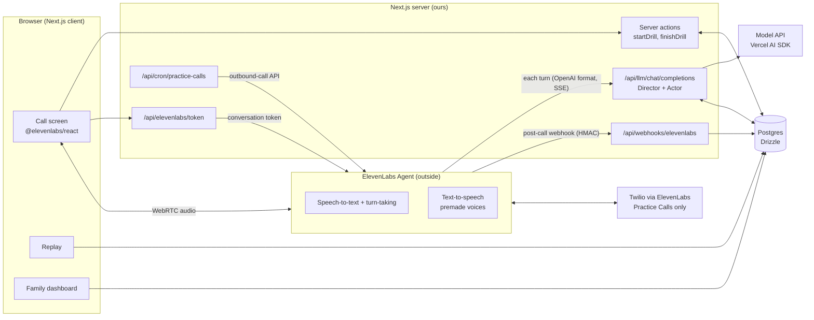
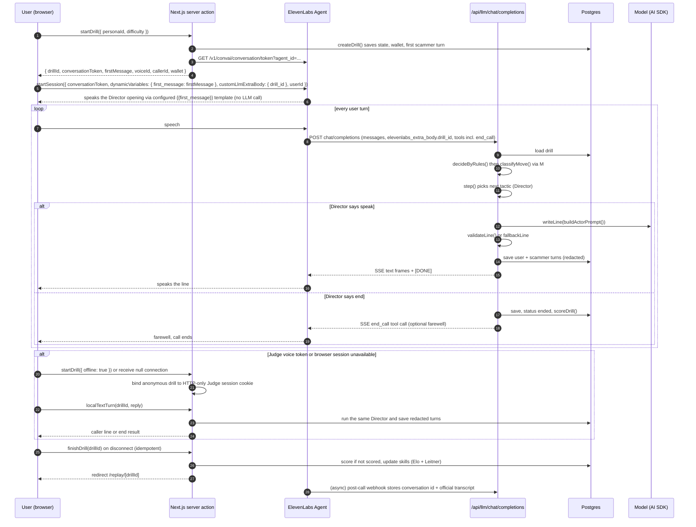

# Architecture

ElevenLabs Agents runs the voice (speech-to-text, turn-taking, interruptions, text-to-speech). Its **Custom LLM** setting sends every turn to our Next.js route, where our TypeScript decides everything. One language, one repo, one deploy.

## System map



## One drill, start to finish



## Components

| Piece | Path | Responsibility |
| --- | --- | --- |
| Engine | `src/lib/engine/*` | Pure logic: Director state machine, taxonomy, scoring, skills, actor prompt, line validator, wallet, rule moves |
| Runtime | `src/lib/drill/runtime.ts` | `createDrill`, `handleCustomLlmRequest`, `finishDrill`; all I/O injected through `RuntimeDeps` |
| Models | `src/lib/llm/models.ts` | `classifyMove` (structured output), `writeLine` (text); timeouts and fallbacks |
| Wire format | `src/lib/llm/sse.ts` | Parse ElevenLabs requests; emit OpenAI chunk frames, `end_call`, buffer words |
| Store | `src/lib/drill/drizzle-store.ts` | `DrillStore` over `drills` + `turns` with transactional optimistic locking and append-only turns |
| Deps factory | `src/lib/drill/deps.ts` (T06) | Builds `RuntimeDeps` from env: store, personas, models, secret, clock, id |
| Routes | `app/api/**` | Thin wrappers; no business logic (see docs/API.md) |
| UI | `app/(app)/**`, `components/**` | Call screen, replay, dashboard (see docs/DESIGN.md) |

## The Custom LLM route contract

Request from ElevenLabs (relevant fields):

```json
{
  "model": "hang-up-director",
  "stream": true,
  "messages": [{ "role": "system", "content": "..." }, { "role": "assistant", "content": "..." }, { "role": "user", "content": "No thanks." }],
  "tools": [{ "type": "function", "function": { "name": "end_call", "parameters": {} } }],
  "user_id": "user_123",
  "elevenlabs_extra_body": { "drill_id": "drl_9f3..." }
}
```

- Auth: `Authorization: Bearer <HANGUP_LLM_SECRET>` (set as the Custom LLM API-key secret in ElevenLabs). Reject others with 401.
- Our own transcript in Postgres is authoritative. ElevenLabs' `messages` are only used for the latest user utterance.
- Response: `text/event-stream`, OpenAI `chat.completion.chunk` frames, then `data: [DONE]`. To end the call, stream an `end_call` tool call and `finish_reason: "tool_calls"`.
- If the drill is unknown, ended, or expired: stream `end_call` with "Sorry, wrong number." Never 500 mid-call.

## Drill binding and security

- Drill IDs are 128-bit random (`crypto.randomUUID()` prefixed `drl_`), so they can't be guessed.
- At drill creation the server signs a 15-minute session token containing the drill ID, owner and expiry. The browser passes it as `customLlmExtraBody.session_token`. The route verifies the HMAC and drill ID before checking ownership. This keeps signed-in calls working when ElevenLabs omits `request.user_id`. Legacy callers without a token still need their matching `request.user_id`.
- A drill accepts turns only while `status = "live"` and for 15 minutes after `startedAt`.
- `customLlmExtraBody` is client-supplied; validate it and verify session-token signatures before trusting any identity claims. Tokens cannot authorize a different drill or outlive their expiry.

## Latency budget (targets to measure, not guarantees)

| Step | Target |
| --- | --- |
| Rule decision | under 5 ms |
| Classifier (only when rules don't decide) | under 600 ms, hard timeout 1.5 s, then `unclear` |
| Actor line | under 900 ms, hard timeout 2.5 s, then `fallbackLine` |
| First audio after user stops talking | under 1.5 s |

Mitigations, in order: a fast small model for both calls; skip the classifier when rules decide; buffer words (`bufferFrame`) when the classifier ran; prefetch nothing that writes state.

## Failure modes

| Failure | Behavior |
| --- | --- |
| Model provider down or slow | Classifier → `unclear`; Actor → scripted `fallbackLine`. Drill continues. |
| Model line names a real org, has a URL, breaks character | `validateLine` fails → `fallbackLine` |
| ElevenLabs token or browser session unavailable | Every browser practice mode can continue with local text in the same drill; a server action calls the same runtime without audio. Text selections never start a provider session. |
| DB write conflict (two requests for one turn) | Optimistic lock fails → respond with the last saved scammer line again, do not double-step |
| Unknown or ended drill | `end_call` frames |
| Database outage | Do not treat it as a version conflict. The provider gets a complete SSE `end_call`; a failed finish stays on a stopped call screen with Retry replay. |
| Webhook signature invalid | 401, nothing stored |

## Environments and config

See `.env.example`. All env vars are validated in `src/env.ts` with Zod at boot. Server-only secrets never use the `NEXT_PUBLIC_` prefix. The Custom LLM runtime loads the six persona cards statically and shares one Drizzle store and AI Gateway models per process. `ACTOR_MODEL` and `CLASSIFIER_MODEL` accept AI Gateway IDs; defaults are `openai/gpt-4.1-mini` and `openai/gpt-4.1-nano`. Local model calls need `AI_GATEWAY_API_KEY`; if a model provider is unavailable, the runtime uses the engine's safe fallback line or `unclear` classification.

On Vercel production, an unset `APP_URL` or `BETTER_AUTH_URL` resolves from `VERCEL_PROJECT_PRODUCTION_URL`, not a request Host header. Explicit configured origins still take precedence. Pilot assessments carry `is_assessment=true`; they receive a replay but never update skills or item difficulty. Active participants' holdout persona is excluded from browser practice and recommendations.

## Deployment

Vercel. Route handlers run on the Node.js runtime. Postgres on Neon (pooled connection string for the app, direct one for migrations). Vercel Cron triggers `/api/cron/practice-calls` (protected by `CRON_SECRET`). Preview deploys use a separate ElevenLabs agent (`ELEVENLABS_AGENT_ID` per environment) pointed at the preview URL.
